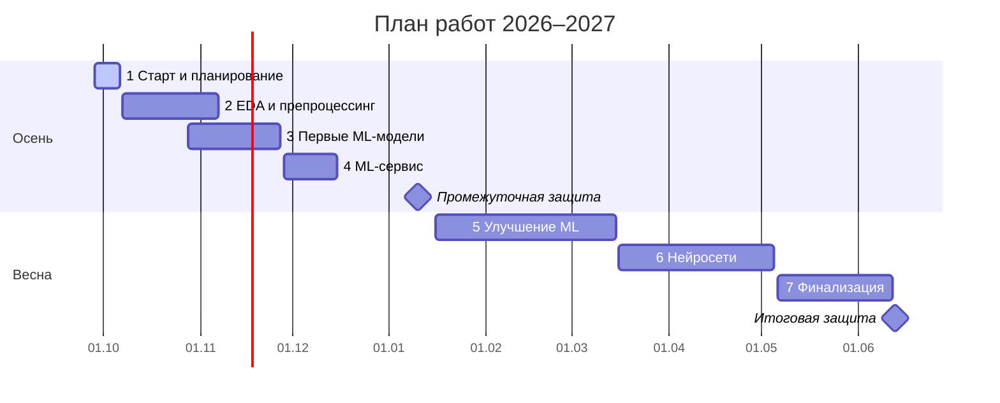

<div align="center">

# 🕵️ Детекция дипфейков на фото лиц

### Обобщение на незнакомые генераторы

Годовой проект №35 · Магистратура «Искусственный интеллект» · НИУ ВШЭ · 2026–2027


</div>

---

## 📌 О проекте

Детекторы дипфейков хорошо работают на академических датасетах, но заметно хуже – на изображениях генераторов, которых не было в обучении. В реальной жизни приходят именно такие.

**Цель:** построить сервис, который по фото лица определяет признаки дипфейка, и честно проверить его работу на фейках незнакомых генераторов.

**Исследовательский вопрос:** что лучше ловит фейки незнакомых генераторов – простая модель на предобученных признаках или дообученная нейросеть?

## 👥 Команда

| Участник | GitHub |
| --- | --- |
| Дмитрий Маслов | [@Dima-ML](https://github.com/Dima-ML) |
| Аяз Валиев | [@ayazvaliev](https://github.com/ayazvaliev) |
| Герта Лазовская | [@Gerta-L](https://github.com/Gerta-L) |
| Андрей Устамчук | – |

**Куратор:** Илья Скворцов

## 🎯 Постановка задачи

| | |
| --- | --- |
| **Задача** | Бинарная детекция: real / fake |
| **Домен** | Фото лиц |
| **Фейк** | Изображение лица, полностью синтезированное или с заменой / редактированием лица |
| **Вход сервиса** | Фото (JPEG / PNG) |
| **Выход сервиса** | Одно из трёх состояний: «обнаружены признаки» / «не обнаружены» / «недостаточно данных» + версия модели и порог |

Почему три состояния: при малой доле подделок среди загрузок значительная часть тревог любого детектора ложная, поэтому сервис сообщает о признаках подделки, а не выносит вердикт. «Недостаточно данных» – если на фото нет лица, оно слишком маленькое или изображение сильно сжато.

## 🗂 Данные

Требования: публичный и популярный датасет, от ~3000 сэмплов на класс, сбалансированный, фото без тяжёлого препроцессинга.

| Датасет | Что внутри | Роль по умолчанию |
| --- | --- | --- |
| Deepfake and Real Images (OpenForensics) | ~190 тыс. кропов лиц 256×256 | Кандидат в основной |
| 140k Real and Fake Faces | FFHQ + StyleGAN | Тест обобщения |
| DF40, подмножество | 40 техник подделки с метками метода | Тест по типам атак |
| Четвёртый – по итогам поиска | Фото лиц в рамках требований | По итогам EDA |

На этапе EDA каждый участник разбирает свой датасет, основной и тестовые выбираем по результатам. Ссылки на датасеты появятся после чекпойнта 2.

## 📊 Результаты EDA

Общий EDA команды – [EDA.ipynb](EDA.ipynb), практическая применимость проекта – [docs/practical_applicability.pdf](docs/practical_applicability.pdf).

### 140k Real and Fake Faces

Автор: [@Dima-ML](https://github.com/Dima-ML) · ноутбук: [notebooks/eda_140k.ipynb](notebooks/eda_140k.ipynb) · для сравнения – подвыборка 10 тыс. Kaggle-кропов OpenForensics

| Показатель | 140k | OpenForensics |
| --- | --- | --- |
| Файлов на диске / в индексе | 140 000 / 140 000 | 190 335 / 10 000 (подвыборка) |
| train / valid / test | 100 000 / 20 000 / 20 000 | 7 356 / 2 072 / 572 |
| real / fake | 70 000 / 70 000, 50/50 в каждом сплите | 5 000 / 5 000, 50/50 в каждом сплите |
| Не открываются / не RGB / нестандартный размер | 0 / 0 / 0 | 0 / 0 / 0 |
| Размер картинок | 256×256 | 256×256 |
| Качество JPEG (real = fake) | 95 | 75 |
| Субдискретизация / progressive / EXIF / ICC | 4:2:0 / нет / нет / нет | 4:2:0 / нет / нет / нет |
| AUC размера файла, max(AUC, 1 − AUC) | 0.544 (real больше) | 0.557 (fake больше) |
| Имя файла выдаёт класс | да (длина 5 vs 10) | да (префикс) |

**Выводы:**
- Шорткатов по метаданным внутри датасетов нет: формат, размер, качество JPEG и прочие поля у real и fake одинаковы, размер файла разделяет классы слабо.
- Имена файлов выдают класс в обоих датасетах, в признаки их не берём.
- Качество JPEG различается между датасетами (95 и 75), в кросс-датасетной проверке это контролируем.
- По средним картинкам: в 140k лица выровнены одинаково, в OpenForensics кадрирование real и fake различается.

#### Статистики лица

MediaPipe FaceLandmarker, выборка: 140k – по 5000 real и fake из train+valid, OpenForensics – все train+valid индекса. Рамка лица строится по точкам лица и не включает верх лба и волосы. Сравнение real и fake – KS-тест.

| Показатель | 140k | OpenForensics |
| --- | --- | --- |
| Лицо не найдено, real / fake | 0.06% / 0.00% | 1.87% / 1.74% |
| 2 и более лиц, real / fake | 0.78% / 0.02% | 16.67% / 8.80% |
| KS D face_area | 0.100 | 0.463 |
| KS D face_cx | 0.071 | 0.072 |
| KS D face_cy | 0.105 | 0.308 |
| KS D yaw | 0.054 | 0.100 |
| KS D roll | 0.099 | 0.069 |
| KS D brightness (p) | 0.021 (0.21) | 0.039 (0.0014) |
| KS D bg_brightness (p) | 0.021 (0.20) | 0.035 (0.0067) |

Для остальных величин p < 1e-6.

#### Детектор-читер

Можно ли отличить real от fake по признакам, не связанным с подделкой: метаданные, положение и поза лица, яркость, резкость, цветность. Логрегрессия и HistGradientBoosting, обучение на train, ROC-AUC на valid.

| Показатель | 140k | OpenForensics |
| --- | --- | --- |
| ROC-AUC, метаданные (logreg / boosting) | 0.545 / 0.531 | 0.652 / 0.556 |
| ROC-AUC, лицо | 0.600 / 0.723 | 0.807 / 0.827 |
| ROC-AUC, картинка | 0.597 / 0.589 | 0.704 / 0.661 |
| ROC-AUC, все признаки | 0.635 / 0.731 | 0.839 / 0.869 |
| ROC-AUC, logreg на лице + признаки отклонения | 0.677 | 0.804 |
| Топ-3 permutation importance (boosting, все) | face_cx и roll, затем yaw и sharpness примерно наравне | face_area, sharpness, face_cx |
| Лучший одиночный признак, max(AUC, 1 − AUC) | sharpness 0.593 (real больше) | face_area 0.81 (fake больше) |
| KS D резкости в лице / на фоне | 0.131 / 0.109 (real выше) | 0.152 / 0.129 (fake выше) |
| Доля ч/б (chroma < 3), real / fake | 0.0000 / 0.0000 | 0.0106 / 0.0207 |

**Выводы:**
- Без взгляда на подделку real и fake различимы: AUC до 0.87 на OpenForensics и до 0.73 на 140k. Это планка шортката, бейзлайн должен её превзойти.
- OpenForensics: главный сигнал – кадрирование (face_area AUC 0.81), второй – резкость, причём одинаково в лице и на фоне, то есть это шорткат обработки, а не след подделки.
- OpenForensics: fake в valid отличаются от fake в train по резкости, кадрированию и размеру файла, официальный valid не годится для подбора порога.
- 140k: поза и положение лица у fake собраны у среднего, признаки отклонения поднимают логрегрессию с 0.600 до 0.677.
- Единый кроп нужен обоим датасетам; 140k уже нарезан по стандарту команды (см. «Препроцессинг»).

#### Дубликаты и утечки

Почти-копии: pHash (расстояние Хэмминга ≤ 8) с подтверждением по MAE на серых миниатюрах 64×64. Точных копий нет.

| Показатель | 140k |
| --- | --- |
| Пар почти-копий (fake–fake / real–real) | 19 556 (19 539 / 17) |
| Групп почти-копий / максимальный размер группы | 12 921 / 7 |
| fake с почти-копией в train: valid / test | 32.5% / 31.4% |
| Чистый test (без почти-копий в train и valid), real / fake | 9 996 / 6 381 (82% test) |

**Выводы:** утечка есть только у fake – генератор выдавал почти одно и то же лицо. Главные метрики считаем на чистом test, train и будущие сплиты делим по группам почти-копий.

#### Препроцессинг

Стандарт команды – YuNet, квадрат 1.3 × сторона рамки лица, выход 256×256. 140k уже нарезан почти так: поле вокруг лица ≈1.34 у обоих классов, а квадрат 1.3× не помещается в кадр у 31% картинок (одинаково у real и fake). Повторный кроп дал бы интерполяцию и изменил резкость, которая в 140k – след генератора, поэтому 140k используем как есть. Пересжатие, повороты и цветокоррекция в препроцессинге не делаются.

#### Бейзлайн: радиальный FFT + логрегрессия

Признаки: серое изображение → окно Ханна → 2D FFT → log амплитуды, среднее по кольцам (127 чисел). Обучение – 17 188 картинок train без почти-копий, сбалансированных по позе; C и порог (FPR = 1%) подобраны на чистом valid, test используется один раз.

| Набор | ROC-AUC | TPR @ FPR 1% | Ложные тревоги с порогом valid |
| --- | --- | --- | --- |
| test 140k чистый | 0.673 | 0.050 | 1.1% |
| test 140k чистый, JPEG 75 | 0.665 | 0.047 | 8.0% |
| test 140k, подобран по читеру (без шортката позы) | 0.634 | 0.035 | 1.5% |
| OpenForensics (незнакомый генератор) | 0.563 | 0.008 | 11.7% |
| *ориентир: читер на признаках вне подделки* | *0.73* | – | – |
| *кандидат для чекпойнта 3: FFT по направлениям + бустинг (valid)* | *0.789* | – | – |

**Выводы:**
- Частотный сигнал 140k слабый и ниже планки читера; без шортката позы – 0.634, около пятой части сигнала связано с позой.
- Сжатие почти не снижает AUC, но сдвигает порог (8.0% ложных тревог вместо 1%); на незнакомом генераторе бейзлайн работает почти наугад.
- Ограничивают признаки, а не модель (бустинг на тех же признаках +0.02). Спектр по 4 направлениям даёт 0.765–0.789 на valid, прирост держится на высоких частотах – первый кандидат для чекпойнта 3.

#### Аугментации

Бейзлайн переобучен с одной аугментацией за раз (вероятность 0.5), C и порог – на чистом valid без аугментаций.

| Аугментация | ROC-AUC, чистый test | Ложные тревоги на JPEG 75 | ROC-AUC, OpenForensics | Эффект |
| --- | --- | --- | --- | --- |
| нет (бейзлайн) | 0.673 | 8.0% | 0.563 | – |
| JPEG 60–95 | 0.670 | 2.7% | 0.551 | помогает |
| уменьшение 128–224 | 0.665 | 1.7% | 0.539 | помогает |
| размытие σ 0.5–1.5 | 0.661 | 1.3% | 0.526 | вредит (−0.012 на чистом test) |
| JPEG + размытие | 0.662 | 1.5% | 0.544 | вредит (−0.011, на грани) |
| яркость и контраст ±20% | 0.673 | 7.8% | 0.563 | не влияет |
| отражение, поворот на 90° | – | – | – | бесполезны: радиальный профиль не меняется |

**Выводы:** аугментации чинят калибровку, а не разделимость – порог становится устойчив к сжатию, но AUC на незнакомом генераторе не растёт. Для следующих моделей берём JPEG 60–95 и уменьшение; для признаков по направлениям отражение и поворот меняют секторы местами и требуют отдельной проверки.

## 📏 Метрики

| Метрика | Зачем |
| --- | --- |
| ⭐ **TPR при FPR = 1%** на незнакомых генераторах | Главная: сколько фейков ловим, обвиняя не больше 1% настоящих фото |
| ROC-AUC, AUC на худшем генераторе, EER | Качество ранжирования и худший случай |
| ΔAUC под деградациями | Устойчивость к цепочке «уменьшение → JPEG → пересохранение» |
| Brier, ECE | Калибровка: можно ли показывать уверенность модели |

## 🧪 Подход

```
FFT-признаки + логрегрессия   →   классический ML       →   эмбеддинги CLIP / ResNet   →   fine-tuning нейросетей
        (бейзлайн)                 (LBP, DCT, цвет, SRM)        + простой классификатор        (EfficientNet, ResNet, Xception)
```

**Принципы:**
- одна гипотеза за раз – каждый эксперимент меняет одну вещь;
- сравнение моделей при равных данных, сплитах, разрешении и бюджете;
- метрика фиксируется заранее, порог – на отдельном калибровочном наборе;
- контроль шорткатов: классификатор только по метаданным файлов должен давать AUC ≈ 0,5;
- метрики по каждому генератору отдельно плюс худший случай.

## 🗓 План работ

| № | Этап | Сроки | Результат |
| :-: | --- | --- | --- |
| 1 | Старт и планирование | до 6 октября | Тема, план, репозиторий, README |
| 2 | EDA и препроцессинг | 7 октября – 7 ноября | EDA по датасетам, выбор основного и тестовых, сплиты, проверка утечек и шорткатов |
| 3 | Первые ML-модели | 28 октября – 27 ноября | Бейзлайн, классические модели на ручных признаках, таблица метрик |
| 4 | ML-сервис | 28 ноября – 15 декабря | FastAPI + Docker, три состояния, кроп лица, правило отказа, публичная ссылка |
| 🎤 | Промежуточная защита | 10–15 января | Результаты осени, демо сервиса, план на весну |
| 5 | Улучшение ML | январь – 15 марта | Эмбеддинги CLIP и CNN, тест на незнакомых генераторах, устойчивость, калибровка |
| 6 | Нейросети | 16 марта – 5 мая | Fine-tuning, сравнение ML и DL по обоим протоколам |
| 7 | Финализация | май – июнь | MLflow, воспроизводимость, анализ ошибок |
| 🏁 | Итоговая защита | 13–20 июня | Ответ на исследовательский вопрос, финальный сервис |



## ⚙️ Окружение и данные

Общее окружение для всех ноутбуков и скриптов – `environment.yml` (Python 3.11, зависимости с точными версиями). Команды выполняются из корня репозитория:

```bash
bash scripts/setup_environment.sh
source "${CONDA_ROOT:-$HOME/miniconda3}/etc/profile.d/conda.sh"
conda activate deepfake
```

`setup_environment.sh` ставит Miniconda (если её нет), создаёт окружение `deepfake` и ядро Jupyter «Python (deepfake)». Без conda: `python3.11 -m venv .venv-team`, установить в него pip-пакеты из `environment.yml` с теми же версиями и зарегистрировать ядро `python -m ipykernel install --user --name deepfake --display-name "Python (deepfake)"`.

Модели – YuNet и MediaPipe FaceLandmarker, с `--include-baseline` ещё ResNet18; сохраняются в `models/`:

```bash
bash scripts/download_models.sh
bash scripts/download_models.sh --include-baseline
```

Датасеты сохраняются в `data/raw`, другой путь задаётся переменной `DEEPFAKE_DATA_ROOT`:

| Датасет | Команда | Что скачивается |
| --- | --- | --- |
| 140k Real and Fake Faces | `bash scripts/download_datasets.sh --datasets 140k` | Kaggle xhlulu/140k-real-and-fake-faces целиком → `data/raw/140k` |
| OpenForensics, Kaggle-кропы | `bash scripts/download_datasets.sh --datasets openforensics_crops` | Kaggle manjilkarki/deepfake-and-real-images → `data/raw/openforensics_crops` |
| OpenForensics, оригинал | `bash scripts/download_datasets.sh --datasets openforensics --limit 70300 --seed 42` | 70 300 размеченных кадров и JSON разметки Train / Val / Test-Dev с Zenodo → `data/raw/openforensics` |
| MFFI | `bash scripts/download_datasets.sh --datasets mffi --mffi-test-only --limit 20000 --seed 42` | файл меток обычного Test и 20 000 JPG → `data/raw/mffi`; все 181 947 – `--limit 181947` |
| DF40 | `python scripts/download_df40.py --root data/raw/df40 --max-images 100000 --seed 42` | до 100 000 изображений native EFS + FE → `data/raw/df40` |

Полный композит – загрузка всех датасетов, индексация, препроцессинг и сплиты в `data/splits/composite_full` – собирается командой `bash scripts/prepare_composite.sh --profile full`, уменьшенный – `--profile demo`.

## 📁 Структура репозитория

```
├── configs/             # параметры композитных сплитов и препроцессинга, словарь генераторов
├── data/
│   ├── manifests/       # инвентарь DF40 с источником и хешами (в git)
│   ├── raw/             # скачанные датасеты (не в git)
│   ├── processed/       # кэши признаков и препроцессинга (не в git)
│   └── splits/          # собранные сплиты (не в git)
├── datasets/            # опубликованные композитные сплиты: описание в JSON, таблица в Git LFS
├── docs/                # документы проекта
├── models/              # веса YuNet, MediaPipe, ResNet18 – создаётся загрузчиком (не в git)
├── notebooks/           # EDA по датасетам: eda_140k, eda_openforensics, eda_mffi, eda_df40
├── scripts/             # окружение, загрузка данных и моделей, препроцессинг, сборка сплитов
├── src/
│   ├── notebook_src/    # функции EDA, которые импортируют ноутбуки
│   └── preprocessing/   # общий препроцессинг: кроп лиц, JPEG, дубликаты, сплиты
├── tests/               # unittest для src/preprocessing и скриптов загрузки
├── EDA.ipynb            # общий EDA команды
├── environment.yml      # общее окружение: Python 3.11, зависимости с точными версиями
├── LICENSE
└── README.md
```

## 🤝 Как работаем

- Разработка в отдельных ветках, изменения – через pull request.
- Эксперименты логируем в MLflow начиная с чекпойнта 3.
- Каждый созвон команды транскрибируем, договорённости – в чат.
